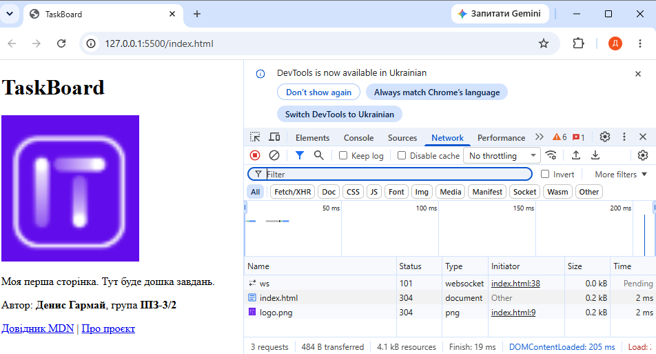
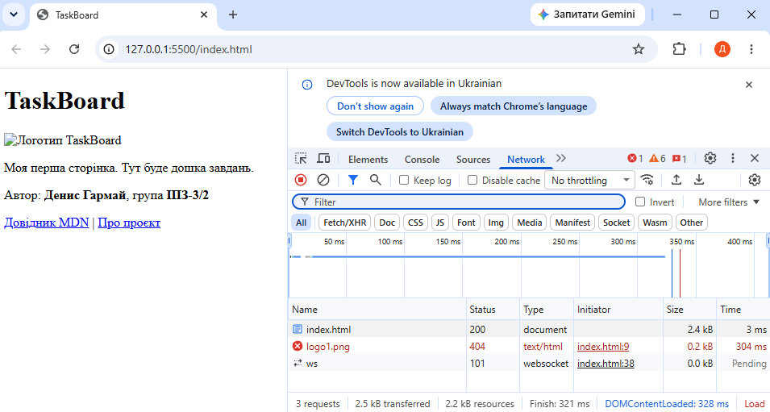

# Звіт до лабораторної роботи №5

## 1. Таблиця запитів (DevTools → Network)

**Заголовки відповіді для `index.html` (Headers):**
- **Request URL:** `http://127.0.0.1:5500/index.html`
- **Request Method:** `GET`
- **Status Code:** `200 OK`
- **Content-Type:** `text/html; charset=UTF-8`

**Результати перевірки Elements та Console:**
- Зміна тексту у вкладці **Elements** не змінює вихідний файл `index.html` на диску, тому після оновлення сторінки (`F5`) початковий текст повертається.
- Команда `document.title` у **Console** повернула `'TaskBoard'`, а `document.body.style.background = "lightyellow"` пофарбувала фон сторінки у світло-жовтий колір (ці зміни також зникають після `F5`).

## 2. Відповіді на контрольні запитання

1. **Яка адреса сторінки в браузері? З яких частин вона складається?**
   Адреса сторінки в браузері — `http://127.0.0.1:5500/index.html`. Вона складається з протоколу передачі даних (`http://`), локальної IP-адреси комп'ютера (`127.0.0.1`), номера порту локального сервера (`5500`) та шляху до конкретного файлу на сервері (`/index.html`).

2. **Скільки запитів зробив браузер при завантаженні сторінки і чому саме стільки?**
   Браузер виконав 3 запити (або 4, враховуючи службовий WebSocket-запит Live Server): перший — для отримання самого HTML-документа (`index.html`), другий — для завантаження зображення (`logo.png`), вказаного в тегу ``, і третій — автоматичний запит браузера на іконку вкладки (`favicon.ico`). Кожен зовнішній ресурс, підключений на сторінці, потребує окремого HTTP-запиту до сервера.

3. **Що відбулось, коли ти поставив неправильний шлях до зображення?**
   Сервер не зміг знайти файл за вказаним шляхом `images/logo1.png` і повернув HTTP-відповідь зі статусом `404 Not Found` (у вкладці Network запит підсвітився червоним). На самій сторінці замість картинки відобразилася стандартна іконка зламаного зображення та альтернативний текст із атрибуту `alt` («Логотип TaskBoard»).
   

4. **Чому зміни, зроблені через DevTools, зникли після F5?**
   Інструменти розробника (DevTools) змінюють лише поточну копію документа (DOM-дерево), завантажену в оперативну пам'ять браузера, не редагуючи вихідні файли на диску. Після натискання `F5` браузер відправляє новий GET-запит на сервер і заново відмальовує сторінку з оригінального файлу `index.html`.

5. **Хто в цій схемі клієнт, а хто сервер?**
   У цій схемі клієнтом виступає веббраузер, який надсилає HTTP-запити та відображає отриману сторінку користувачеві. Сервером є розширення Live Server у VS Code, яке працює на локальному комп'ютері (`127.0.0.1:5500`), приймає запити від браузера та віддає йому потрібні файли проєкту.

## 3. Додаткове завдання

- **Перехід за адресою `http://127.0.0.1:5500/qwerty`:** Live Server повернув відповідь зі статусом `404 Not Found` та текстову сторінку помилки з повідомленням `Cannot GET /qwerty`, оскільки такого файлу або маршруту в папці проєкту немає.
- **Порівняння `curl -I http://127.0.0.1:5500/index.html` із DevTools:** Утиліта `curl -I` надсилає `HEAD`-запит і виводить лише HTTP-заголовки відповіді сервера (`HTTP/1.1 200 OK`, `Content-Type: text/html; charset=UTF-8`, `Content-Length`, `Date`, `ETag`), не завантажуючи тіло сторінки. Ці заголовки повністю збігаються з розділом **Response Headers** у вкладці Network в DevTools.

